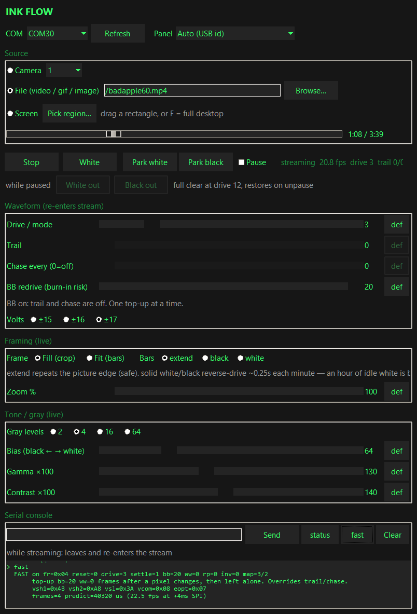
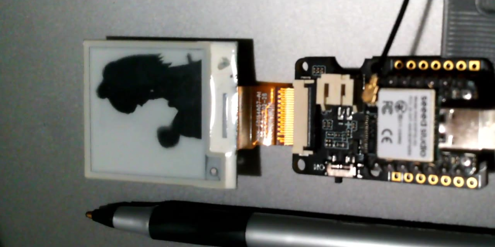
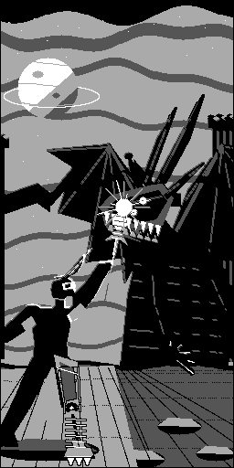

<p align="center">
  
</p>

# fastwave

**Custom waveforms for SPI e-paper. Measured, not folklore.**

The vendor's "fast partial refresh" on an SSD16xx controller takes 336 to 540 ms.
The same panels, driven from here, do a readable update in 24 to 89 ms — and on
one of them the fast waveform is also **higher contrast than the vendor's**,
because the stock table is not a quality/speed tradeoff you are undoing. It is
slow *and* worse.

| panel | vendor | here | ratio |
|-------|-------:|-----:|------:|
| 5.79", 792x272, two cascaded SSD1683 | 336 ms | 48–89 ms |
| 4.26", 800x480, SSD1677 | 540 ms | 30 ms up |
| 1.54", 200x200, SSD1681 | 363 ms | 72 ms |

Streamed video on the same hardware, with no flashing between frames: **12.4 fps
at 800x480**, and on the 200x200 anything from 13 to 34 fps depending on how hard
the drive is pushed. The rate there is a choice rather than a ceiling — pick the one
nearest the source video's own frame rate, so frames are not being dropped
unevenly.

Every number in this repository came off a BUSY pin or out of a calibrated
camera crop. Where something was inferred rather than measured, it says so.
Where something is unfinished, it is in [docs/OPEN-WORK.md](docs/OPEN-WORK.md)
rather than quietly absent.

---

## Disclaimer — experimental, out of spec, the glass will stain

This driver can run the panel **far outside what the module is sold for**.
Treat it as experimental. A signage or reader warranty assumes a handful of
full refreshes a day. **One minute of video here is on the order of that
entire five-year budget** — tens of updates per second, every second.

Burn-in (DC stain, ghost images, a field that will not come clean) is the
nature of driving e-ink this hard. It will happen. ±17 V is the datasheet
ceiling; **±18 V or higher is fast, permanent damage** — see
[docs/BURN-IN.md](docs/BURN-IN.md).

After a long stream, play a restore pattern for a few hours: full black and
full white, over and over, many thousands of times. That is what actually
relaxes the film. Short version: Ink Flow **Park**, or serial `scrub 10` /
`blink 20` left looping. A differential poke will not lift a stain.

---

## Ink Flow

The live host for the same waveforms: webcam, video, image, GIF, or a dragged
screen region, dithered and delta-streamed onto the glass. No flash between
frames.

<p align="center">
  
</p>

<p align="center">
  <a href="https://www.youtube.com/watch?v=9FRypKoAvRs">
    
  </a>
  <br><em>Demo video &mdash; 1.54" glass, live stream (YouTube)</em>
</p>

```
python tools/ink_flow.py
```

Drive, trail, chase, framing and tone are knobs. The CLI is
`python tools/webcam.py COMx`. The wire is in
[docs/STREAMING.md](docs/STREAMING.md). How not to stain the panel is
[docs/BURN-IN.md](docs/BURN-IN.md).

| panel | streamed |
|-------|----------|
| 4.26", 800×480 | **12.4 fps** |
| 1.54", 200×200, drive 8 | 13 fps |
| 1.54", 200×200, drive 4 | 22 fps |
| 1.54", 200×200, drive 2 | 34 fps |

On the 1.54" that whole range is usable — 20, 25 and 30 fps all look good. Drive
count and `fr` set the rate, and they are chosen as a pair — see
[docs/panels/SSD1681-1.54.md](docs/panels/SSD1681-1.54.md).
Match it to the source video's frame rate rather than reaching for the highest
number: a rate that does not divide into the source is what produces skipped and
uneven-looking frames.

---

## Where to go

**[docs/START-HERE.md](docs/START-HERE.md)** routes by what you are trying to do.

If you want the short version: **[docs/WAVEFORM-LAW.md](docs/WAVEFORM-LAW.md)**
is the one file that matters — the timing equation, the `0x22` bitfield, the LUT
anatomy, and where the milliseconds actually go.

If you have a panel nobody here has seen, hand
**[prompts/PORT-TO-YOUR-PANEL.md](prompts/PORT-TO-YOUR-PANEL.md)** to a coding
agent. It fetches the current release, asks you eleven questions about your
wiring, and works through the bring-up ladder in the right order.

## What is in here

```
docs/          the reference material — read START-HERE first
docs/panels/   per-panel measurement records, one file per glass
ports/         three working firmware ports (PlatformIO, Arduino framework)
tools/         Ink Flow GUI, CLI streamer, serial, optical measurement
prompts/       the port-it-to-my-hardware prompt
art/           Ink Flow shots, and the four-level plate at the bottom
```

### The three ports

| directory | hardware | what it does |
|-----------|----------|--------------|
| `ports/ssd1683-crowpanel-579/` | 5.79" dual SSD1683, ESP32-S3 | waveform lab: `calib`, `seqscan`, `probe`, live mode switching, video |
| `ports/ssd1677-seeed-426/` | 4.26" SSD1677, XIAO ESP32-S3 | bench + video streamer + native 4-level grey stills |
| `ports/ssd1681-154/` | 1.54" SSD1681, XIAO ESP32-S3 | video/webcam bench with the full probe set |

Each builds with `python -m platformio run -d ports/<name>` and talks over
serial at 115200. `help` lists the commands.

## The three findings, if you read nothing else

**1. BUSY = frames x frame period, and content does not affect it.** Minimum,
median and maximum update time are identical over hundreds of frames. Both terms
are registers you control. A windowed transfer saves SPI and never saves
waveform time.

**2. `0x22` is a bitfield, not a magic byte.** The vendor sequence ramps the
analog rails up and down on every single update, which measures **+91 ms** on
one part and +91–124 ms on another. Bring the rails up once and fire bare
DISPLAY bytes, and the fixed cost measures zero. Separately, bit 4 reloads the
factory waveform from OTP — which is why a custom LUT mysteriously stops working
the moment you call a vendor helper.

**3. Source voltage is free contrast.** The datasheet maximum (±17 V) drives a
pixel harder at an identical frame count. Confirmed on glass: busy stayed at
exactly 89 ms with the boost on. The benefit grows as the mode gets faster,
which is the regime any of this runs in. **±18 V or anything higher is fast,
permanent burn-in. Never. The `volts` command will not write it.** See
[docs/BURN-IN.md](docs/BURN-IN.md).

And one negative result worth as much as the three above: the activate byte that
several libraries ship as a documented fast path, on one of these parts, is
DISPLAY in **3-colour mode** on a black-and-white panel. That is the inversion
and cascade asymmetry it has always produced.

## Before you trust a number

Read [docs/MEASURING.md](docs/MEASURING.md). Timing does not lie, because it is
a pin. Image quality lies constantly, and the five specific ways it lied during
this work — including a metric that scored an 8 ms drive and a 200 ms drive
within seven points of each other, convincingly, for months — are written down.

---

## Provenance and licence

Free for any use, including commercial, with attribution: **Apache License 2.0**,
see [LICENSE](LICENSE) and [NOTICE](NOTICE). Ship it in a product, link it, fork
it, sell the board it runs on. Keep the licence and the NOTICE with it, say what
you changed, and the patent grant in section 3 covers you.

The SSD1683 port's file naming and its bitmap font table descend from the board
vendor's demo code for that panel; the driver bodies, the waveform builder and
the SPI path were rewritten and are what the measurements refer to. The other
two ports are original.

Hardware named here is named because it is what was on the bench. Nothing in
this repository is endorsed by, or affiliated with, any of the manufacturers
involved.

One of the panels used had a genuine manufacturing fault, and the note about it
is kept because it cost a session: the symptom looked exactly like a waveform
problem and every waveform explanation for it was wrong. Voltages stay inside
the datasheet throughout — the source rails go to the specified maximum and no
further, and every port's `volts` command refuses an out-of-spec value rather
than writing it.

<p align="center">
  
  <br>
  <em>Grayscale test — four native SSD16xx levels, no dither.</em>
</p>

---

## Acknowledgements

Claude (Anthropic) and Grok (xAI) both contributed to this work, in equal
measure — the probes, the waveform builders, the hosts, and the writing up of
what the glass actually did.

---

## Use it

Free for anything — commercial products, personal projects, whatever you are
building. Ship it, link it, sell the board it runs on. All I ask is attribution,
and that you **link back to this repository rather than forking it**: the numbers
here get corrected when the glass says otherwise, and a fork freezes them at
whatever was true the day it was cut.

Made by Bootdsc for all you Chooms to use, copy and modify.
